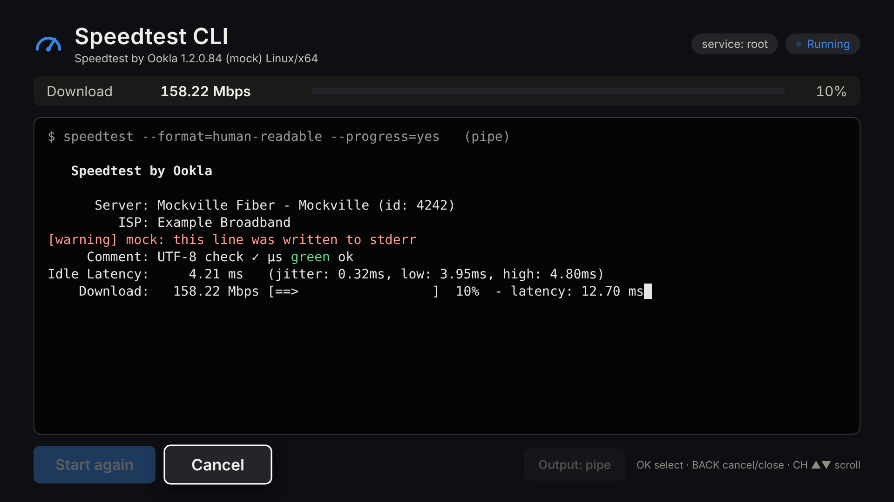
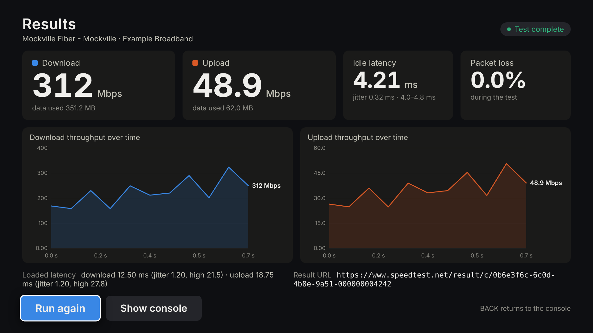

# Speedtest CLI for LG webOS (Homebrew)

A webOS Homebrew app that runs the **official Ookla Speedtest CLI** on a rooted LG TV and shows its real terminal output live: progress-bar redraws in place, stdout and stderr as they arrive, and the final summary and result URL left on screen. When a test finishes, a results screen shows the numbers and throughput charts.

Target: rooted LG OLED C3 (O22N), webOS 10.2.2, firmware 33.23.05, with Homebrew Channel installed.

| Live console | Results |
|---|---|
|  |  |

> These screenshots come from the desktop test harness with the mock CLI. They are not from a TV. See [Verification status](#verification-status).

## How it works

```
app (HTML/CSS/JS)  ──Luna subscription──▶  io.github.danzig666.speedtest.service (Node)
  terminal emulator                           spawn /media/developer/speedtest/speedtest
  result parser + charts                            --format=human-readable --progress=yes
                                                stdout/stderr ──▶ UTF-8 decode ──▶ batched events
```

* **Service** (`service/`): a JS service with two methods, `start` (a subscription) and `cancel`. The binary path and argument list are fixed. Callers can only choose how output is captured: `pipe` (default) or `pty`. There is no shell, and only one test runs at a time. Each run has two time limits: 4 minutes in total, and 60 seconds without any output. On a limit or Cancel, the service sends SIGTERM to the process group, then SIGKILL after 3 seconds. If the app closes, Luna drops the subscription and the service kills the process.
* **Before each run** the service checks the binary: it must exist, be executable, and be an ELF file for the TV's CPU. It then runs `speedtest --version`. Each failure gets a specific message: missing, not executable, wrong CPU, broken, licence not accepted, CLI failed, stalled, or timed out.
* **Output** is decoded per stream with `StringDecoder`, so a UTF-8 character split between chunks is rebuilt correctly. Chunks are batched about every 40 ms and sent as `{s:'out'|'err', d:'raw text'}`. Control characters and ANSI sequences are passed through unchanged.
* **Console** (`app/js/terminal.js`): a small terminal emulator. It handles CR, LF, BS, TAB, cursor movement, erase in line and display, and SGR colours. Each stream (stdout, stderr) has its own parser state, so an escape sequence split across chunks, or interrupted by a stderr chunk, is never corrupted. stderr is shown in red.
* **PTY mode** (`native/ptyrun`, written in Rust): a static helper (about 300 KB) that runs the CLI with a pseudo-terminal on stdout and stderr and `/dev/null` on stdin. The idea comes from webOS Terminal's `ptybridge`. The jail blocks `/dev/ptmx`, so PTY mode needs an elevated service.

## Install

1. **Install the app.** Download `io.github.danzig666.speedtest_<version>_all.ipk` from [Releases](../../releases) or from the CI artifacts. Then use one of these:
   ```sh
   # from a PC with webOS CLI tools (ares-setup-device already configured)
   ares-install io.github.danzig666.speedtest_1.0.0_all.ipk

   # or on the TV over SSH (copy the ipk to /tmp first)
   luna-send-pub -i 'luna://com.webos.appInstallService/dev/install' \
     '{"id":"com.ares.defaultName","ipkUrl":"/tmp/io.github.danzig666.speedtest_1.0.0_all.ipk","subscribe":true}'
   ```
2. **Install the Ookla CLI** on the TV: see [Binary setup](#binary-setup). The CLI is not included in this repo or the .ipk.
3. Open **Speedtest CLI** from the launcher and press **Start test**.

## Binary setup

The app runs exactly this file: **`/media/developer/speedtest/speedtest`**, with `HOME=/media/developer/speedtest`. Ookla stores its licence and GDPR acceptance in `$HOME/.config/ookla/speedtest-cli.json`, so that file ends up in the same directory.

Use the official **Linux armel** build, 1.2.0:

```sh
ssh root@TV_IP            # rooted TVs: Homebrew Channel's SSH, port 22 (or 9922 in dev mode)

mkdir -p /media/developer/speedtest
cd /media/developer/speedtest
curl -fL -o /tmp/ookla.tgz https://install.speedtest.net/app/cli/ookla-speedtest-1.2.0-linux-armel.tgz
tar -xzf /tmp/ookla.tgz speedtest && rm /tmp/ookla.tgz
chmod 755 speedtest
./speedtest --version
```

If `curl` on the TV refuses the download, download the .tgz on a PC and copy it over: `scp ookla-speedtest-1.2.0-linux-armel.tgz root@TV_IP:/tmp/`.

The expected `--version` output looks like this (the kernel part will differ on the TV):

```
Speedtest by Ookla 1.2.0.84 (ea6b6773cf) Linux/arm-linux-musleabi … arm/armv7l
```

The armel build is a static 32-bit ARM (EABI5) musl binary, so it does not depend on the TV's libc.

**Accept the licence and privacy terms yourself, once.** The app never answers these prompts. It runs the CLI with stdin closed, and if consent is missing it stops and tells you what to do. Run the CLI interactively with the same HOME the app uses:

```sh
HOME=/media/developer/speedtest /media/developer/speedtest/speedtest
```

Read the terms and type `YES` at each prompt. The CLI then runs one test in your SSH session. After that, the app can run tests.

## Elevation (when needed)

The service first runs with the default Homebrew-app privileges (jailed user `prisoner`). That is enough for pipe mode, as long as the jail lets the service see and run `/media/developer/speedtest/speedtest`. You need to elevate the service (run it as root, outside the jail) if:

* the app says the binary is missing or not accessible, even though it is installed, or
* you want **PTY output mode** (the jail blocks `/dev/ptmx`).

Press **Elevate service** in the app. The button appears for these errors and calls Homebrew Channel's `elevateService`. Or do it over SSH:

```sh
/media/developer/apps/usr/palm/services/org.webosbrew.hbchannel.service/elevate-service io.github.danzig666.speedtest.service
/usr/sbin/ls-control scan-services
pkill -f 'io[.]github[.]danzig666[.]speedtest[.]service'
```

Elevation is lost when the app is reinstalled or updated, so run it again after that. The header shows `service: root` or `service: jailed (uid …)`.

## Using it

| Remote | Action |
|---|---|
| ◀ ▶ ▲ ▼ | move focus (▲ from the buttons enters the console) |
| OK | press the focused button |
| ▲ ▼ in the console, CH ▲/▼ | scroll the output |
| BACK | results → console; while running → cancel; error shown → dismiss; otherwise exit the app |
| Magic Remote pointer | hover to focus, click to press; hover a chart for exact values |

**Output: pipe / pty** switches how the CLI's output is captured. Pipe mode is the default and needs the fewest privileges. If the progress bar doesn't update in pipe mode on your TV, switch to pty (this needs elevation).

When a test succeeds, the results screen opens automatically. It shows download and upload in Mbps (converted if you use another unit), idle latency with jitter and low/high, packet loss, loaded latency, server, ISP, the result URL, and download and upload throughput over time. The throughput charts are built from the live progress lines. Press BACK to return to the full CLI output.

## Build from source

Requirements: Node ≥ 20, Rust (stable) with musl targets. No cross-compiler is needed, because the helper links with `rust-lld`.

```sh
rustup target add armv7-unknown-linux-musleabihf aarch64-unknown-linux-musl x86_64-unknown-linux-musl
npm ci
npm run build:pty      # -> service/bin/ptyrun-{armv7,aarch64,x86_64}
npm test               # see below
npm run package        # -> dist/io.github.danzig666.speedtest_<ver>_all.ipk (verified)
```

`npm run package` stages `app/` and `service/` and runs `ares-package` from `@webos-tools/cli`. It then checks the archive: the helpers are mode 0755, no `speedtest` binary is inside, and no file has a 1970 date.

**Desktop harness:** `npm run dev` serves the app at http://127.0.0.1:8099/. It runs the real `service.js` behind a `PalmServiceBridge` shim, with the mock CLI. Set `MOCK_MODE` to `fail`, `license`, or `stall`, and `MOCK_SCALE` to change the speed.

**CI/release** (`.github/workflows/build.yml`): every push builds the helpers, runs all tests (including the official armel binary under QEMU), packages the .ipk, and uploads it with SHA256SUMS and screenshots as artifacts. Pushing a tag `vX.Y.Z` that matches `appinfo.json` also publishes a GitHub Release with the .ipk.

## Tests

`npm test` runs 29 tests:

* **Mock CLI** (`test/mock/`): delayed progress, `\r` redraws, ESC[K, ANSI sequences split across writes, UTF-8 characters split across writes, stderr lines, and modes for success, failure (exit 2), licence prompt, and stall.
* **Runner** (`test/runner.test.js`): output arrives while the process is still alive; Cancel kills the real process (checked by PID); a second run starts cleanly; only one run at a time; failures, the licence prompt, the stall timeout, and the overall timeout (with SIGKILL escalation) are each detected; missing, non-executable, and wrong-architecture binaries are rejected. In PTY mode, the CLI sees a TTY, Cancel reaches it, and an endless licence prompt is stopped.
* **Official binary under QEMU** (when `OOKLA_ARMEL_BIN` and `QEMU_ARM` are set): checks the `--version` preflight; pipe mode shows the licence instructions and exits with code 1; PTY mode re-prompts and is stopped with `LICENSE_REQUIRED`. Nothing is ever accepted.
* **Service** (`test/service.test.js`, with a fake `webos-service`): only `start` and `cancel` exist; `start` requires a subscription; a second subscriber gets BUSY; the keep-alive is released; dropping the subscription (app closed) kills the process.
* **UI end-to-end** (`test/e2e.test.js`, Playwright, skipped if Playwright is not installed): driven only with arrows, Enter, and BACK (keyCode 461). Runs Start, Cancel, Start again, results screen, BACK, a failure error, a licence error, and closing the page while a test runs.

## Troubleshooting

```sh
# Is the CLI there and runnable? (same HOME the app uses)
ls -l /media/developer/speedtest/speedtest
HOME=/media/developer/speedtest /media/developer/speedtest/speedtest --version
ls -l /media/developer/speedtest/.config/ookla/      # licence/GDPR acceptance

# Drive the service without the app
luna-send -i -f 'luna://io.github.danzig666.speedtest.service/start' '{"subscribe":true}'
luna-send -n 1 -f 'luna://io.github.danzig666.speedtest.service/cancel' '{}'

# Is a test process still running?
ps -ef | grep -v grep | grep -E 'speedtest|ptyrun'

# Is the service elevated? Exec= should point to Homebrew Channel's run-js-service
grep '^Exec=' /var/luna-service2-dev/services.d/io.github.danzig666.speedtest.service.service

# Service log
tail -f /var/log/messages | grep -i speedtest
```

| Message | Fix |
|---|---|
| *Speedtest CLI not found* | Install it at the exact path shown under [Binary setup](#binary-setup). If it is already there, [elevate](#elevation-when-needed) the service. |
| *not executable* | `chmod 755 /media/developer/speedtest/speedtest` |
| *built for x86-64 / ARM64 …* | You downloaded the wrong build. Use the **linux-armel** .tgz. |
| *licence / privacy terms have not been accepted* | Run the interactive SSH command above with `HOME=/media/developer/speedtest`. |
| *No output for 60 s* / *took longer than 240 s* | Check the network. Try the other output mode. |
| *Could not allocate a pseudo-terminal* | Elevate the service, or switch output back to `pipe`. |
| `Unknown method` / service missing | Reinstall the .ipk. Make sure the service shows up in `ls /media/developer/apps/usr/palm/services/`. |
| `ConfigurationError … Could not retrieve or read configuration` | The CLI could not reach `www.speedtest.net`. Check DNS, network, and proxy settings on the TV. |

## Verification status

| Check | Where it ran |
|---|---|
| Official armel 1.2.0 binary: format (static ARM EABI5), `--version`, licence-prompt behaviour on pipe and on TTY | **QEMU user-mode on x86-64** (not the TV) |
| Format strings used by the parser (`%12s: %13s (data used: …)`, ` Packet Loss: …`, spinner `-\|/`, `[=…]` bar) | Extracted from the official binary |
| Streaming before exit, Cancel kills the process, second run, timeouts, error messages, UTF-8 and ANSI split handling, one run at a time | **Mock CLI**, desktop Node 22, pipe and PTY modes |
| ptyrun armv7 build runs | QEMU (`ptyrun -- /bin/echo`) |
| Luna service contract, subscription cancel → kill | Fake `webos-service` |
| UI with remote keys, results screen | Chromium (Playwright) via the dev harness |
| **Anything on the LG C3 / webOS 10.2.2** | **Not run.** The build environment cannot reach your TV. |

Still to verify on the TV, in this order:

1. Install the binary and run `--version`.
2. Accept the terms over SSH.
3. Run a test in pipe mode. Check that the progress line updates before the CLI exits.
4. Press Cancel during the download phase. Check with `ps` that the process is gone.
5. Run a second test.
6. Close the app during a test. Check with `ps` again.
7. Try PTY mode after elevating.

A complete network test was never run in development, because accepting Ookla's licence is your decision. So the progress-line layout is inferred from the binary's format strings, and the parser accepts some variation. If the live progress strip or charts stay empty on the TV, the console output is still complete. Please open an issue with a copy of the progress line.

## Security notes

* The service exposes only `start` and `cancel`. It runs a fixed binary with a fixed argument list, passes no user input to the command line, and uses no shell.
* The child process gets a minimal environment: `HOME`, `PATH`, `LANG`, `TERM`, `COLUMNS`, plus proxy variables if the service has them.
* The Ookla binary and its terms stay outside this repo and the .ipk. The app never passes `--accept-license` or `--accept-gdpr`.
* Elevation is optional and only needed when the jail prevents running the CLI or using PTY mode.
